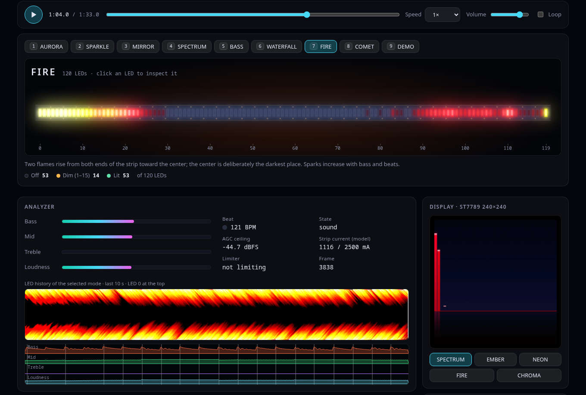
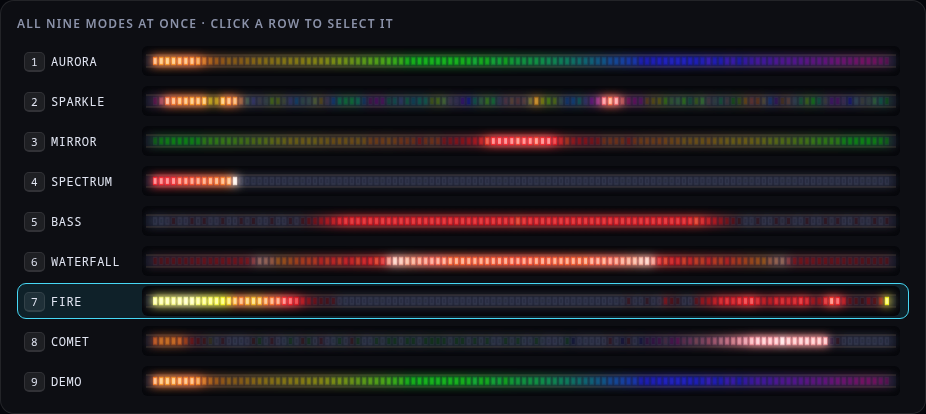

# FFT·VIZ

ESP32 · MAX4466 · ST7789 · WS2812B

[`MIT`](LICENSE) [`ESP32 / Arduino`](tools/build_fw.sh) [`Live preview`](https://4keles.github.io/esp32-fft-visualizer/)

A self-contained ESP32 audio visualizer with a 40-band display and nine music-reactive LED modes. A MAX4466 microphone feeds a portable C++ signal-processing core; an ST7789 display and a WS2812B strip show the result. Daily control is by IR remote or USB serial. Firmware updates use USB; there is no Wi-Fi or OTA.

[](https://4keles.github.io/esp32-fft-visualizer/)

## Try it in your browser

**[Open the live preview](https://4keles.github.io/esp32-fft-visualizer/)**: pick or drop one of your own audio files, or play the built-in demo, and watch what the firmware would do with it.

- The same C++ analyzer and LED engine as the firmware, compiled to WebAssembly, runs live on your audio: 40 bands, AGC, noise floor, beat and BPM, and all nine LED modes at once.
- Your file is decoded and analyzed inside your browser. Nothing is uploaded; the page's content security policy blocks every network request except loading its own files.
- Controls: play, pause, seek and speed; the nine modes; sensitivity (−45 / −52 / −60 dBFS, the remote's key 9); brightness; the emulated 240×240 screen with its five themes; glow or raw wire-value LED drawing.
- The audio goes in at a fixed level (−32 dB into the 12-bit ADC range, no loudness normalization) with a short noise-only lead-in and calibration, like a board that has just been switched on.
- Real-time analysis and drawing use CPU. If the page stutters on a slow device, choose raw wire values and "Selected mode only", and turn the screen preview off.

It is a software preview, not a photograph or a measurement: the audio reaches the core as a direct digital signal instead of through a speaker, a room and the MAX4466, and LED colors are drawn through a display gamma 2.2 approximation.

Run it locally (any static server works; `file://` is blocked by browsers for WebAssembly):

```sh
node tools/serve.mjs            # http://localhost:8080/
# or
python3 -m http.server --directory docs 8080
```

The compiled core is committed (`docs/viewer/fftviz.wasm`), so no build step is needed. To rebuild it you need Node 18 or newer and Zig (`pip install ziglang` into `tools/.venv`, or set `ZIG`):

```sh
sim/build.sh && node sim/test_wasm.mjs
```



## At a glance

- A 40-band spectrum on a 240×240 ST7789 display, with five screen themes.
- Nine LED modes (AURORA, SPARKLE, MIRROR, SPECTRUM, BASS, WATERFALL, FIRE, COMET, DEMO) on a WS2812B strip; the default is 120 LEDs (2 m, 60 LED/m).
- Control by a 17-key IR remote or the USB serial CLI.
- One Arduino application. Firmware is installed over USB only; there is no network feature.
- A portable integer C++17 core with host tests and the browser preview.

## Documentation

| Topic | Document |
|---|---|
| Hardware: circuit, pin map, power, bill of materials, assembly gates | [docs/hardware.md](docs/hardware.md) |
| Remote control and serial overview | [docs/controls.md](docs/controls.md) |
| Serial CLI: commands, parameters, calibration, power model | [docs/cli.md](docs/cli.md) |
| Full schematic and perfboard drawings | [docs/hardware/mimari-v2](docs/hardware/mimari-v2/) |

## Hardware

The part list is in [docs/hardware.md](docs/hardware.md). The classes below describe where each part comes from in this project; they are not parts a new builder may omit.

| Class | Summary |
|---|---|
| Z: required | ESP32 38-pin DevKit, MAX4466 module, ST7789 1.3-inch 240×240, WS2812B 2 m/120 LEDs, 5 V/3.8 A supply, two J1/J2 connector assemblies, SN74HC00N, two 1N4007 (D4, D5), R1 220 Ω, R6 1 kΩ, C2 47 nF, C3 10 nF |
| E1: supplementary | C1 1000 µF, R2 10 kΩ, four 47 Ω resistors, two 10 µF, C5 47 nF, C7 100 µF; electrolytics 16 V |
| E2: protection | T 5 A 5×20 mm glass fuse and holder, D1 1N4007, D2 1N5819, axial ferrite, DIP-14 socket; specified as fitted, not optional bypasses |
| O: feature | SW1 rocker switch, IR receiver with one 17-key handset, 2.4 GHz/50 Ω antenna; the antenna implies no network feature |

> **Safety.** The complete wiring and its physical gates (K1–K11, T-measurements) are in [docs/hardware.md](docs/hardware.md) and are not accepted by any test in this repository.
> - USB is for programming the isolated ESP32 only. Do not power the strip from USB.
> - Do not connect the supply and a PC at the same time until the D3 direction and the VBUS check (T9) pass.
> - Leave GPIO4 unconnected. There is no mode button on it.
> - Current figures (`ma`, `power`) are a model, not a measurement, and the limiter is not a fault protection.

## Build, test and install

Prerequisites: Arduino CLI 1.5 or newer, the ESP32 Arduino core 3.3.12 and Python 3. Host tests also need CMake 3.16 or newer and a C++17 compiler. Install the Espressif board index and core first:

```sh
arduino-cli config init
arduino-cli config add board_manager.additional_urls https://espressif.github.io/arduino-esp32/package_esp32_index.json
arduino-cli core update-index
arduino-cli core install esp32:esp32@3.3.12
```

Compile only (no USB or board operation):

```sh
nice -n 19 tools/build_fw.sh --jobs 4
```

The script uses the core's standard single-application "No OTA" partition scheme, checks that the saved-settings partition (NVS at 0x9000, size 0x5000) did not move and that the application fits, and deletes the merged image that would span NVS. To customize pins and limits, copy `firmware/fftviz/user_config.example.h` to `user_config.h` (ignored by git) before building.

Host tests and the electrical-contract test:

```sh
nice -n 19 cmake -S . -B build
nice -n 19 cmake --build build -j4
nice -n 19 ctest --test-dir build --output-on-failure
python3 tests/test_v2_contract.py
```

Installing is a separate, deliberate step. Read the power warnings in [docs/hardware.md](docs/hardware.md) first; the upload writes the application over USB and leaves the saved settings alone:

```sh
PORT=/dev/ttyUSB0 tools/flash.sh
```

Read-only start over serial (115200 baud, 8N1): opening the port can reset the board and only one program may own it. Wait about 4 seconds, then type `help`, `get`, `power` or `stats`. Saved settings override new defaults.

## Remote control

NEC address `0x00`. The command bytes are the defaults for the author's 17-key handset: sixteen codes were captured from it and key 2 is not yet captured. Another handset can be read with `ir learn on` and set in `user_config.h`. Full details: [docs/controls.md](docs/controls.md).

| Key | Hex | Action |
|---|---|---|
| 1–6 | 45 46 47 44 40 43 | Recall mode slot 1–6 (key 2 capture outstanding) |
| 7 | 07 | Hold 2 s: software standby / wake |
| 8 | 15 | None |
| 9 | 09 | Sensitivity step: −45, −52, −60 dBFS, wrapping |
| 0 | 19 | Short: HUD; hold 2 s: display only |
| LEFT / RIGHT | 08 / 5A | Previous / next LED mode |
| UP / DOWN | 18 / 52 | Brightness +16 / −16 |
| OK | 1C | Next screen theme |
| STAR | 16 | Two presses within 500 ms open slot-save; STAR cancels |
| HASH | 0D | Hold 3 s: two-second quiet calibration |

Save a mode: double STAR, OK, a digit 1–6, OK. Six remote mode slots are separate from the four CLI presets. Display-off keeps audio and LEDs running; standby stops the pipeline and keeps the rails powered.

## Serial CLI

The twelve commands below cover everyday use. Ordinary setters auto-save to NVS five seconds after the last change; `save` writes at once. `reset` deletes the saved settings and presets and `reboot` restarts: neither is a setup step. The full reference is [docs/cli.md](docs/cli.md).

| Command | Purpose | Changes state |
|---|---|---|
| `help`, `help bri` | Help | No |
| `params`, `params ses` | Grouped parameter values | No |
| `get`, `get agcmin` | All values as JSON, or one value | No |
| `mode spectrum` | Select an LED mode | Yes, delayed save |
| `theme neon` | Select a screen theme | Yes, delayed save |
| `bri 120` | Brightness ceiling | Yes, delayed save |
| `agcmin -52` | Sensitivity (AGC floor) | Yes, delayed save |
| `cal` | Learn two quiet seconds as noise | Yes |
| `stats`, `stats 1`, `stats 0` | One status line, start or stop periodic output | Output only |
| `bands` | One 40-band diagnostic snapshot | No |
| `power` | Model-based current and budget, not measured amperage | No |
| `ledtest 5`, `ledtest 0` | Temporary wiring markers, back to normal | Output only |

## Signal path and source map

MAX4466 → ESP32 ADC1 (GPIO34), 48 kHz continuous sampling → 24 kHz decimation (47-tap half-band) → 1024-point real FFT, 60 analysis frames per second → 40 display bands and analyzer (AGC, noise floor, beat and onset) → LED engine (nine modes, gamma, brightness, auto exposure, current limiter) → WS2812B through the RMT peripheral and a 74HC00 buffer. The screen renderer draws the same analyzer output on the ST7789 over SPI. The 60 Hz figure is the analysis rate, not a guaranteed display refresh rate.

The browser preview runs the same core: audio is resampled to 48 kHz, scaled into the ADC domain, and each 800-sample block (one analysis frame) goes through the same analyzer. The nine modes share that single analyzer, so showing all of them costs little extra.

| Path | Contents |
|---|---|
| `core/` | Portable integer (Q15) DSP, LED and screen engine, with generated lookup tables; no heap or runtime float |
| `firmware/fftviz/` | ESP32 application: drivers, CLI, controls, configuration and `user_config.example.h` |
| `tests/` | Behavioral, regression and data tests for the core, firmware logic and the v2 electrical contract |
| `sim/` | WebAssembly build of the core (C ABI, build script, Node test) |
| `docs/` | The interactive preview (`index.html`, `viewer/`), guides and hardware drawings |
| `tools/` | Compile-only build, USB install, table generators, local static server |

## Limits and verification boundaries

- There is no Wi-Fi or OTA; the board is programmed over USB. The web page is a software preview and never talks to the board.
- MAX4466 sensitivity is limited. Quiet music stays close to the noise floor, and the highest sensitivity step can leave bars decaying for about 20 seconds after a loud passage. On the author's board `agcmin -60` raised quiet-music bars about 6.7 times.
- The analyzer does not recognize music or classify sources, and software cannot reconstruct analog clipping.
- The host tests and the electrical-contract test check the code and the netlist. They do not establish assembly, electrical acceptance, LED photometry or current savings. The perfboard geometry (110 × 65 mm) is provisional until K3 passes on the real parts.
- The preview is a model of the analyzer and LED engine, not a result measured on the finished board.
- The project is complete in its current form; there is no roadmap.

## License and acknowledgments

MIT, see [LICENSE](LICENSE). The visual modes and the brightness law derive from Dilum Sanjaya's CodePen "Musical Christmas Lights" (MIT); its notice is in [THIRD_PARTY_NOTICES.md](THIRD_PARTY_NOTICES.md), which also lists the dependencies. Espressif, Arduino and the chip vendors are acknowledged as dependencies and documentation sources, not as endorsements. No audio is distributed with this repository.
